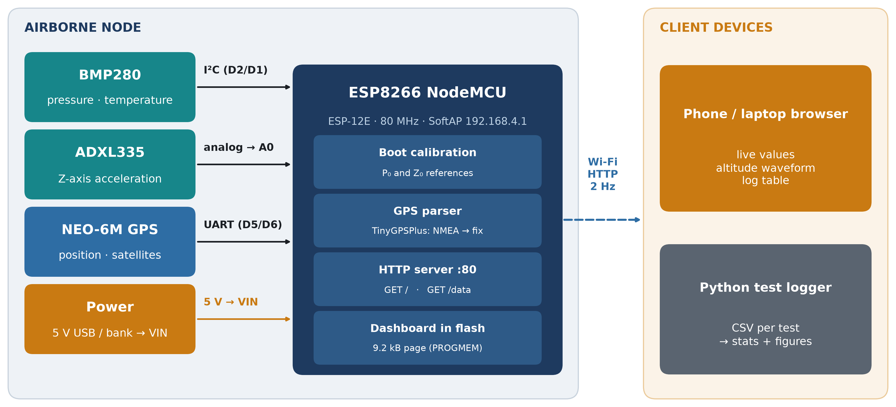
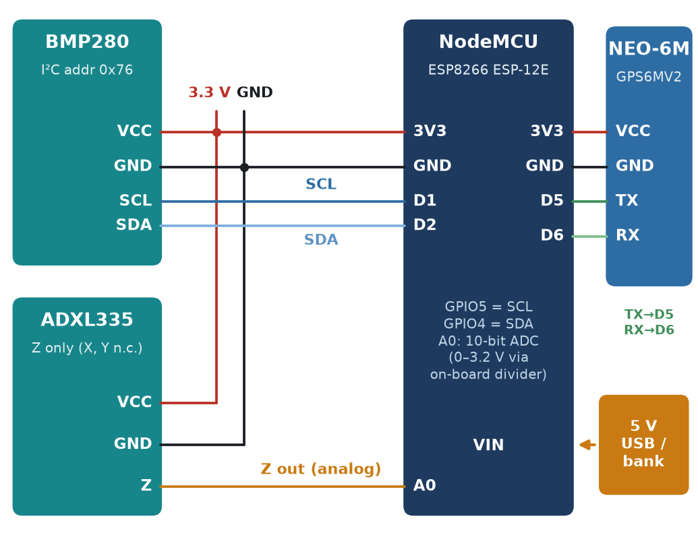
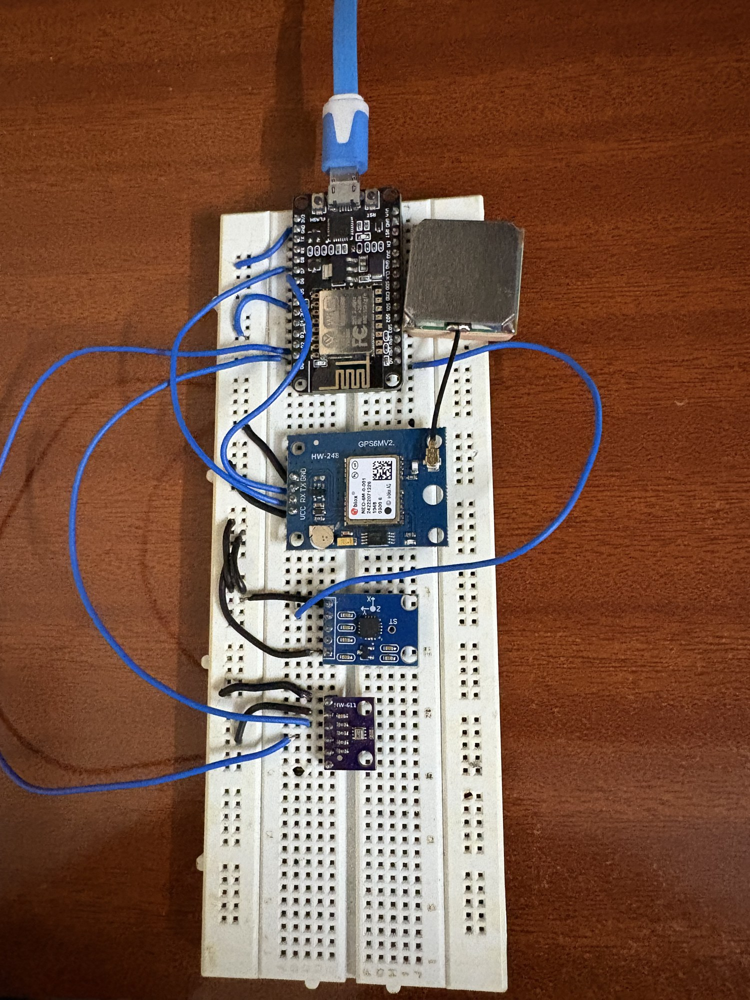

# Wireless Flight Data Recorder (ESP8266 + BMP280 + ADXL335 + NEO-6M GPS)

A low-cost flight data recorder that is its own Wi-Fi network. The ESP8266 starts an access point,
serves a dashboard from flash, and streams relative altitude, pressure, temperature, Z-axis
acceleration and live GPS position from a u-blox NEO-6M to any phone or laptop browser.
No app, router or internet connection is needed.

Embedded Systems DA3 project, VIT Chennai.
Team: Mohammad Amir (24BAI1263), Devansh Rai (24BAI1480). Guide: Suhasini S.



## Hardware

| Part | Connection |
|---|---|
| ESP8266 NodeMCU (ESP-12E) | controller, Wi-Fi SoftAP, web server |
| BMP280 | VCC→3V3, GND→GND, SCL→D1 (GPIO5), SDA→D2 (GPIO4), I²C address 0x76 |
| ADXL335 | VCC→3V3, GND→GND, Z→A0 (X and Y not connected: the ESP8266 has one ADC) |
| NEO-6M GPS (GPS6MV2) | VCC→3V3 (or VIN), GND→GND, **GPS TX→D5 (GPIO14)**, GPS RX→D6 (GPIO12), 9600 baud |
| Power | 5 V from USB or a power bank into the NodeMCU USB port / VIN |





## Repository layout

```
firmware/FlightDataRecorder_GPS/   main sketch: sensors + real NEO-6M GPS (flash this one)
firmware/FlightDataRecorder/       earlier sketch without the GPS receiver
tools/telemetry_logger.py          logs GET /data to a labelled CSV (standard library only)
tools/analyze_results.py           CSV → results/summary.json + figures
tools/generate_simulated_results.py  writes *_SIMULATED.csv test logs (not hardware data)
data/                              test logs
results/                           summary.json, fig_*.png, manual.json (current readings)
docs/                              diagrams, photos, screenshots; make_diagrams.py redraws the diagrams
```

## Flashing the firmware

1. Arduino IDE → Preferences → Additional boards manager URLs:
   `http://arduino.esp8266.com/stable/package_esp8266com_index.json`, then install **esp8266** in Boards Manager.
2. Library Manager: install **Adafruit BMP280 Library** (it pulls in Adafruit Unified Sensor and Adafruit BusIO)
   and **TinyGPSPlus** (by Mikal Hart).
3. Board: **NodeMCU 1.0 (ESP-12E Module)**. Open
   `firmware/FlightDataRecorder_GPS/FlightDataRecorder_GPS.ino` and upload.
4. Serial Monitor at 115200 baud shows the reference pressure, the Z baseline, the dashboard address,
   and every 5 s a GPS line: `GPS chars: … fix: … sats: … lat: … lon: …`.

If your GPS wires are on other pins, change `GPS_RX_PIN` / `GPS_TX_PIN` at the top of the sketch.

Switch the board on where it will start and keep it still for about a second: the altitude and Z-axis
references are captured at power-on.

## Getting a GPS fix

- `GPS chars` stays at 0 → the ESP8266 receives nothing: check that GPS **TX** goes to **D5** and that
  the module has power (its red power LED is on).
- `GPS chars` rises but `fix: no` → the module is working and searching. It needs a clear view of the sky
  (outdoors or at an open window). The first fix after power-up can take from about 30 s to a few minutes.
- With a fix, the small LED on the GPS6MV2 board blinks once per second and the dashboard's
  **LIVE GPS (NEO-6M)** panel turns green and shows latitude, longitude, satellites, HDOP, GPS altitude
  and speed.

## Viewing the dashboard

Join the Wi-Fi network **VIT-Telemetry** (password `telemetry123`) and open **http://192.168.4.1**.
If the page does not load on Android, turn mobile data off or tap "stay connected" when the phone
warns that the network has no internet.

`GET /data` returns one JSON object (about 200 bytes), for example:

```json
{"alt":-0.070,"pre":1004.73,"tmp":24.29,"zRaw":577,"zBase":581,"bmpFound":true,
 "gpsChars":123456,"gpsFix":true,"lat":12.844758,"lon":80.156372,"sats":7,"hdop":1.2,
 "gpsAlt":41.3,"speed":0.4,"gpsAge":412}
```

## Running the tests

Connect the laptop to **VIT-Telemetry**, then from this folder:

```bash
python tools/telemetry_logger.py --test static --minutes 10   # board still on a table
python tools/telemetry_logger.py --test stairs                # type landing heights in metres
python tools/telemetry_logger.py --test tilt                  # type up / side / down
python tools/telemetry_logger.py --test range                 # type distances in metres
python tools/telemetry_logger.py --test gps --minutes 10      # board still, open sky
```

While a test runs, type a label and press Enter. The label is attached to every row that follows.
Type `move` while walking or climbing. Press Ctrl+C to stop.

- **stairs**: type `0` at the start and hold still for a minute. Type `move`, climb one floor, type the
  tape-measured height (for example `3.05`), hold a minute. Repeat for more floors, then come back down
  and type `0` again for the closing check.
- **tilt**: `up` with the board flat and the chip facing up, `side` with it standing on an edge, `down`
  with it upside down. About 20 s each.
- **range**: leave the laptop in one place. Type `5`, carry the board 5 m away and hold for 60 s. Type
  `move`, walk on, type `10`, and so on (10, 20, 30, 40, 50 m), keeping line of sight.
- **gps**: power the board, start the logger straight away, and leave the board still under open sky.
  The analysis reports time to first fix, the share of samples with a fix, satellites, HDOP and the
  position scatter (CEP50 and R95 in metres).
- **current**: read an inline USB power meter while the dashboard is streaming and copy
  `results/manual.example.json` to `results/manual.json` with your readings.

## Analysing the results

```bash
pip install -r tools/requirements.txt
python tools/analyze_results.py
```

This writes `results/summary.json` and `results/fig_static.png`, `fig_stairs.png`, `fig_tilt.png`,
`fig_range.png` and `fig_gps.png` for whichever tests have a CSV in `data/`.

## Dataset format

Each `data/<test>_<date>_<time>.csv` from the logger has one row per request:

| column | meaning |
|---|---|
| time_iso, t_s | wall-clock time and seconds since the logger started |
| label | text typed by the operator (height, orientation, distance, `move`) |
| ok, rtt_ms, error | whether a reply arrived, round-trip time, error type if not |
| alt_m, pressure_hpa, temp_c | BMP280 relative altitude, pressure, temperature |
| z_raw, z_base | ADXL335 Z-axis ADC counts and the power-on baseline |
| bmp_found | 1 if the BMP280 was detected at boot |
| gps_chars, gps_fix, lat, lon, sats, hdop, gps_alt_m, speed_kmph | NEO-6M data (GPS firmware only) |

Files in `data/`:

- `bench_20261025_124907.csv`: bench check transcribed from the dashboard's own log table
  (`docs/dashboard_log_screenshot.png`): time, alt_m, pressure_hpa, z_raw, plus temp_c and z_base from the value cards.
- `*_SIMULATED.csv`: generated by `tools/generate_simulated_results.py`, not recorded from the board.
  Replace them with logger files from real test runs.

## Known limits

Only the Z axis is measured, nothing is stored on the board, Wi-Fi range is short compared with
LoRa or telemetry radios, and the 2 Hz polling rate is too slow for a rocket motor burn. Planned:
MPU6050 or ADS1115 for three axes, SD logging, WebSocket push, and a static port for the BMP280.
